# DocuWare for Docusign IAM

Learn how to install, configure, and use the **DocuWare Extension for Docusign** to connect your DocuWare environment with Docusign, retrieve document information, update index fields, and store signed documents.

## Overview

The DocuWare Extension for Docusign, developed by **ePillars Systems LLC**, integrates DocuWare document management with Docusign eSignature and Maestro workflows.

The integration enables users to:

- Connect DocuWare Cloud or supported on-premises environments to Docusign.
- Access DocuWare File Cabinets and retrieve document index information.
- Search and select existing DocuWare records.
- Create records and update document index fields through Docusign workflows.
- Store completed signed documents in DocuWare.
- Configure Private or Shared connections according to business requirements.

## How to Install and Configure

### Step 1: Locate the DocuWare App in Docusign App Center

In your Docusign account, navigate to **App Center** and search for **DocuWare** by ePillars Systems LLC.

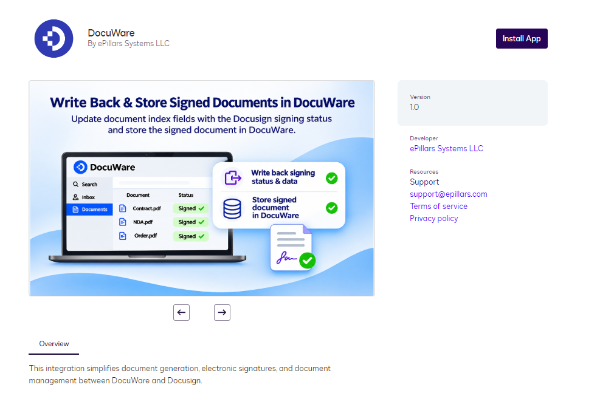

Click **Install App**.

### Step 2: Connect Your DocuWare Account

1. After installing the application, open the DocuWare app from Docusign App Center.
2. Click **Connect Account**.

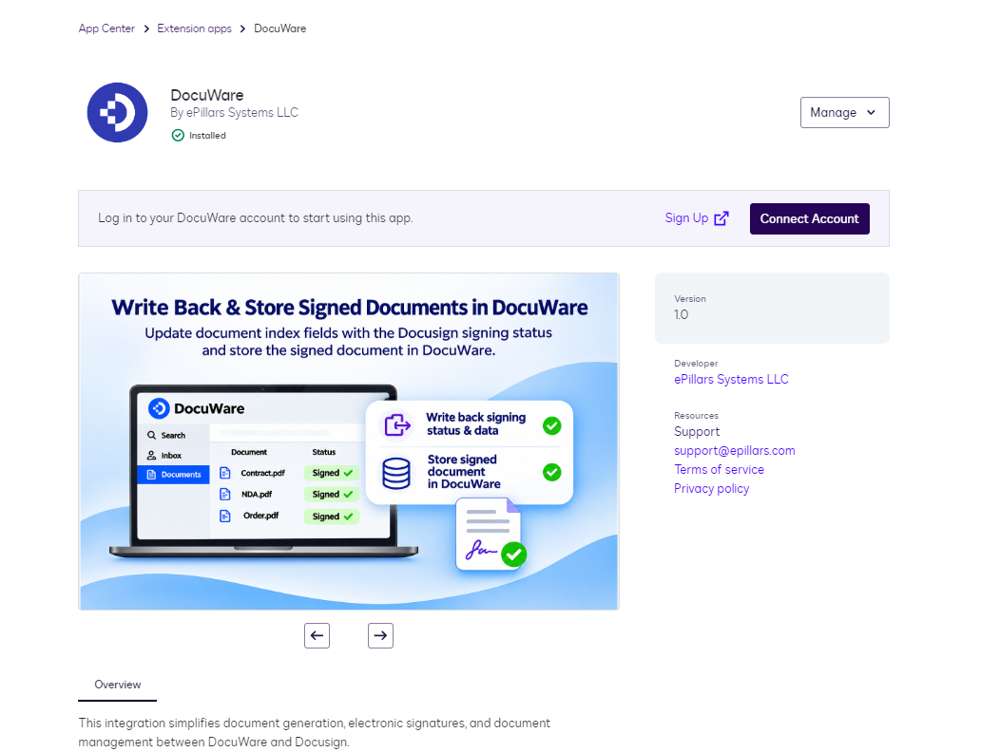

3. Review the authorization information and click **Install and Authorize**.

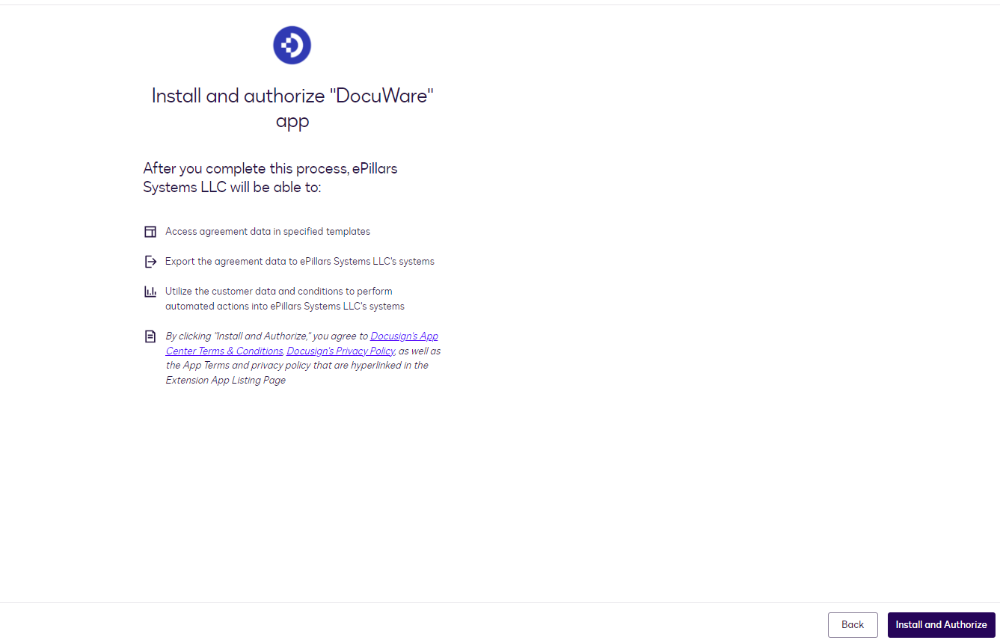

### Step 3: Choose the Connection Type

Select the connection type that meets your organization's requirements.

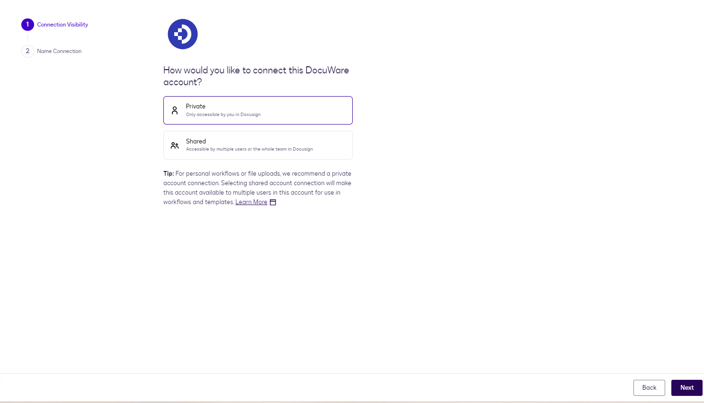

- **Private:** The connection is intended for the individual user.
- **Shared:** The connection can be shared with authorized users according to the available Docusign connection settings.

Choose **Private** or **Shared**, then click **Next**.

### Step 4: Name Your DocuWare Connection

Enter a meaningful name to identify the DocuWare connection.

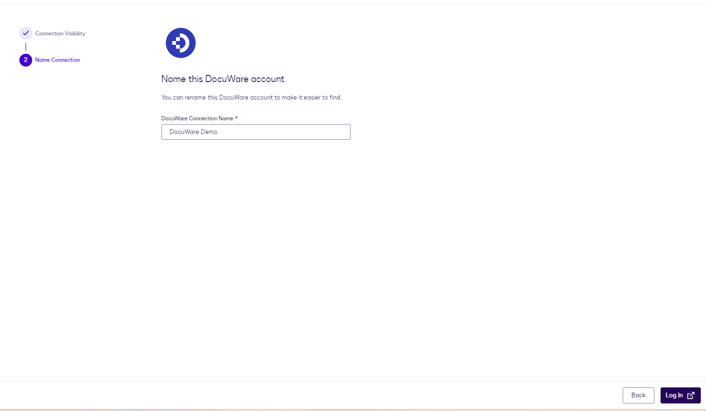

For example, `DocuWare Production` or `DocuWare Test Environment`.

Click **Login** to continue.

### Step 5: Enter Your DocuWare Connection Details

The DocuWare connection page will appear.

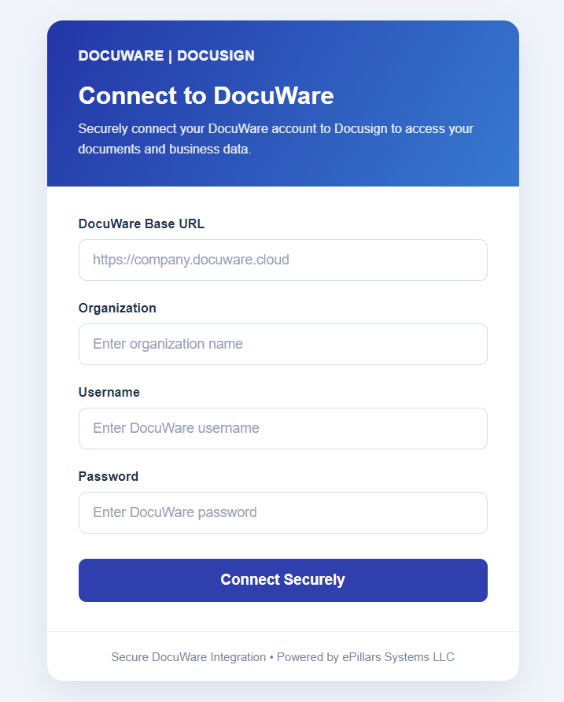

Enter the following information:

- **DocuWare Base URL:** Your DocuWare server address, for example, `https://company.docuware.cloud`.
- **Organization:** Your DocuWare organization name.
- **Username:** Your DocuWare user account.
- **Password:** The password associated with your DocuWare account.

Click **Connect Securely**. The application validates the connection information before proceeding to authorization.

### Step 6: Grant User Consent

After entering the DocuWare connection details, the authorization page appears.

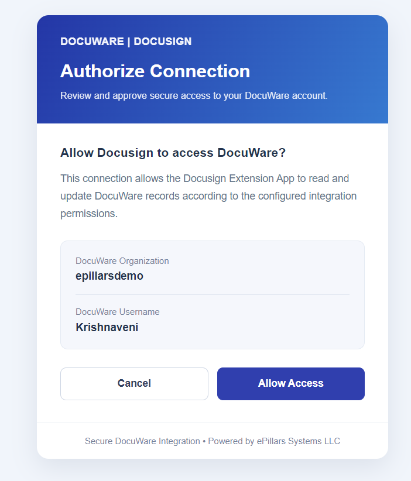

Review the displayed DocuWare organization, username, and requested integration access. Click **Allow Access** to authorize the connection. After successful authorization, Docusign completes the connection process.

## How to Use the App

Open **Docusign Maestro Workflow Builder**, choose the workflow you want to configure, and click **Add Step**. Select the appropriate DocuWare extension action.

### 1. Read Data from DocuWare

Use **Read from DocuWare** to retrieve index fields from existing documents and make them available to later workflow steps.

#### Step 1: Select the connection and DocuWare object

1. Add the **Read from DocuWare** step.
2. Under **Where will you read from?**, select your configured connection, such as `DocuWare demo (Shared)`.
3. Under **DocuWare object**, select the File Cabinet, such as `Accounting`.
4. Click **Next**.

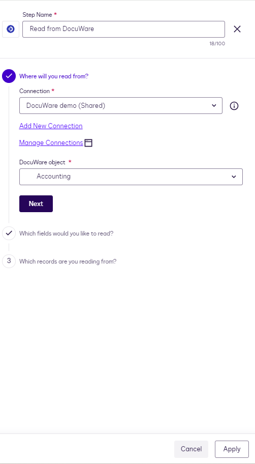

#### Step 2: Choose which fields to read

1. Open **Which fields would you like to read?**
2. Click **Add or Remove Fields**.
3. Select the required index fields. In the example, the selected fields are **Document ID**, **Document Type**, **Company**, **Document Number**, and **Approver**.
4. Click **Save and Exit**, then continue to the next section.

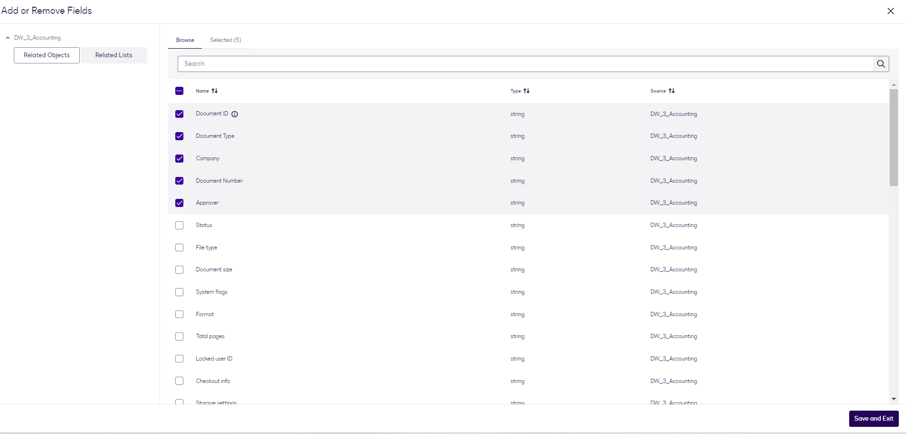

#### Step 3: Configure the record matching rule

1. Under **Which records are you reading from?**, select the DocuWare field to search, such as **Company (string)**.
2. Set the operator to **Equal to**.
3. Under **Workflow field**, select the corresponding workflow variable, such as **Company**.
4. Click **Done**.
5. Choose **A single record** or **Multiple records**, depending on the expected results.
6. Click **Apply** to save the step.

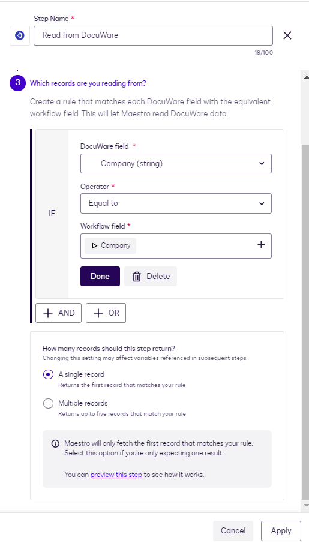

**Example:** Search the Accounting File Cabinet for documents whose **Company** index field equals the Company value supplied by the workflow. If you expect one specific document, use a unique identifier such as **Document ID** rather than a potentially repeated company name.

### 2. Create Records in DocuWare

Use **Writeback to DocuWare** with the **Create** setting to create a record using workflow data.

#### Step 1: Choose the destination and Create action

1. Click **Add Step** and select **Writeback to DocuWare**.
2. Under **Where will you write to?**, choose the DocuWare connection.
3. Select the DocuWare object or File Cabinet, such as **Accounting**.
4. Under **Write settings**, select **Create**.
5. Click **Next**.

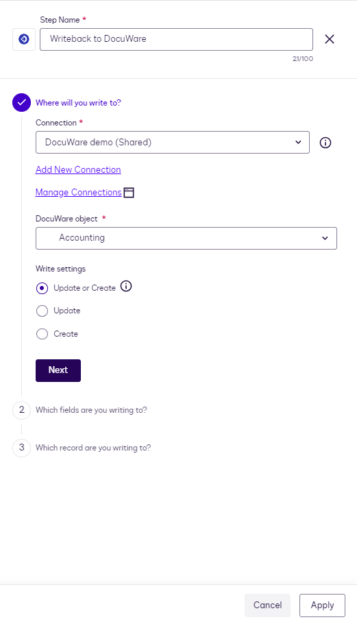

#### Step 2: Map the index fields

1. Click **Add or Remove Fields**.
2. Select the DocuWare fields you want to populate, such as **Document Type**, **Document Number**, **Status**, and **Approver**.
3. For each field, enter a value or use the **+** button to select a workflow variable.
4. Continue through any remaining configuration required for your chosen Create action.
5. Click **Apply** to save the step.

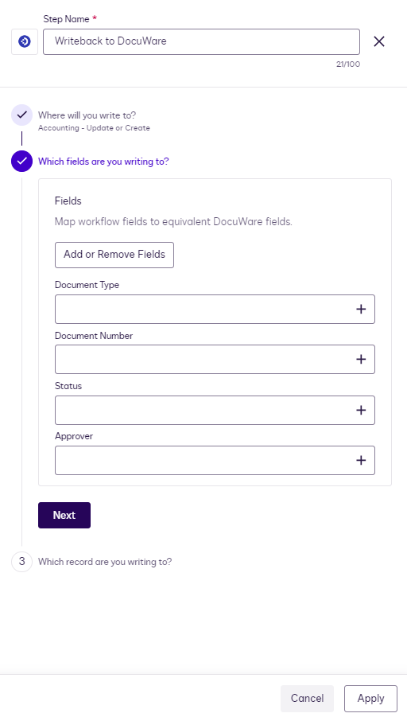

The configured Create action submits the mapped values when the workflow runs. Ensure the required fields and any document-creation requirements of the selected File Cabinet are satisfied.

### 3. Update Existing DocuWare Index Fields

Use **Writeback to DocuWare** with the **Update** setting to modify index fields on an existing document.

#### Step 1: Choose the destination and Update action

1. Add a **Writeback to DocuWare** step.
2. Select your connection and File Cabinet.
3. Under **Write settings**, choose **Update**.
4. Click **Next**.

#### Step 2: Select fields and map their new values

1. Under **Which fields are you writing to?**, click **Add or Remove Fields**.
2. Select the fields you want to update, such as **Status**.
3. Enter a fixed value, such as `Approved`, or use the **+** button to map a workflow field.
4. Click **Next**.

#### Step 3: Identify the document to update

1. Under **Which record are you writing to?**, select **Document ID (string)**.
2. Set **Operator** to **Equal to**.
3. For **Workflow field**, select the **Document ID** output from an earlier **Read from DocuWare** step.
4. Click **Done**, then **Apply**.

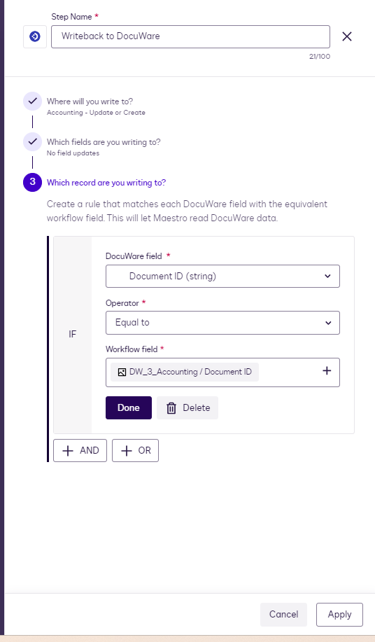

**Example:** Update the **Status** field to `Approved` in the Accounting File Cabinet where the **Document ID** matches the ID returned by the earlier Read step.

**Important:** The matching Document ID must refer to the intended existing document. Avoid using a broad matching rule that could identify multiple records.

### 4. Store Signed Documents in DocuWare

Use the extension's **File Output System of Record** action to store a completed Docusign document against an existing DocuWare record.

#### Step 1: Choose the file to store

1. Add the DocuWare File Output System of Record extension step to your Maestro workflow.
2. Under **You're storing a file**, select a document or envelope from an earlier workflow step.
3. Click **Next**.

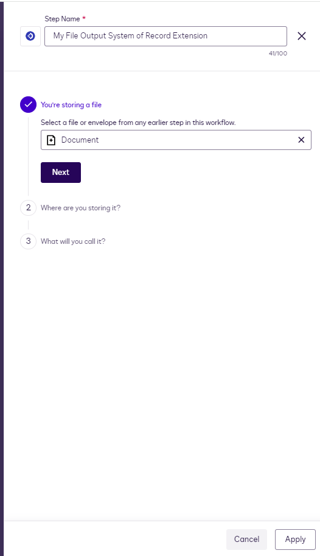

#### Step 2: Select the DocuWare destination

1. Under **Where are you storing it?**, choose the DocuWare connection.
2. Under **Select record**, map the **Document ID** of the existing DocuWare record.
3. Under **Object**, choose the corresponding DocuWare File Cabinet, such as `DW_3_Accounting`.
4. Click **Next**.

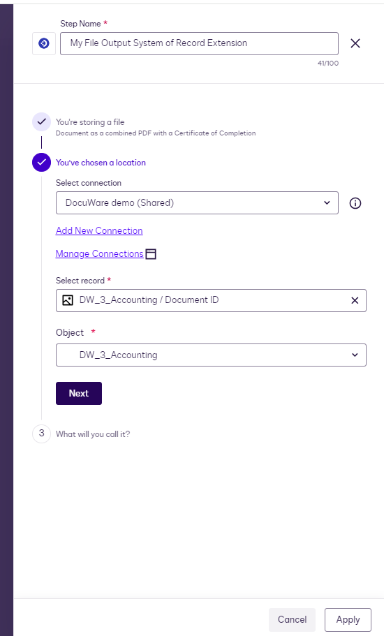

#### Step 3: Configure the stored file name

1. Under **What will you call it?**, enter the desired file-name text or add workflow variables.
2. Use the file-name controls to build the required name.
3. Review the selected **Object ID** and destination details.
4. Click **Apply** to save the step.

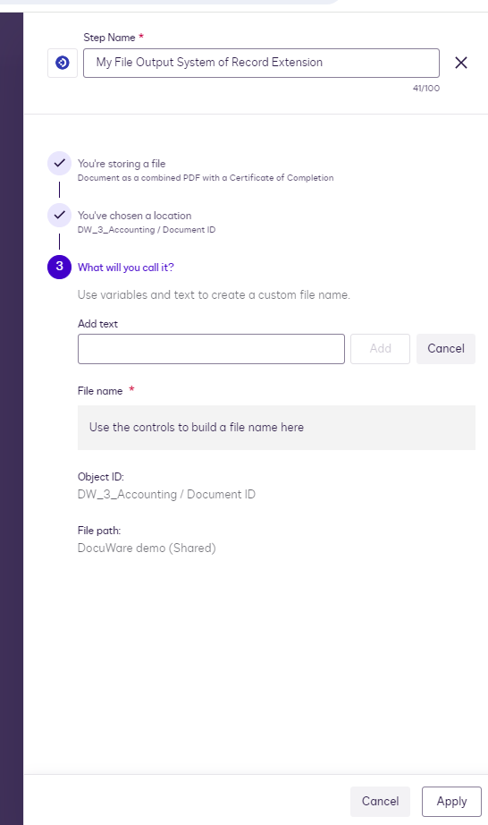

When the workflow runs successfully, the File Output action sends the selected file to the configured DocuWare destination. The screenshots demonstrate selecting an **existing record** using its Document ID; confirm that this ID is available from a preceding step.

## Frequently Asked Questions

### Does the DocuWare Extension support DocuWare Cloud and on-premises installations?

Currently, the DocuWare Extension supports DocuWare Cloud only. Support for DocuWare on-premises installations is planned for a future release.

### Can multiple users connect using different DocuWare accounts?

Yes. The integration is designed to support separate DocuWare connections for different users and organizations, subject to configured connection permissions.

### What is the difference between Private and Shared connections?

- **Private:** Intended for use by the individual connection owner.
- **Shared:** Can be made available to authorized users according to Docusign connection-sharing settings.

### Can I update existing DocuWare documents?

Yes. **Writeback to DocuWare → Update** can update supported document index fields when the workflow correctly identifies the existing document.

### Can I create new records in DocuWare?

Yes. The extension provides a **Create** action. The requirements depend on the selected File Cabinet and its configuration.

### Can I store completed Docusign documents in DocuWare?

Yes. The File Output capability can store a selected completed document against a configured DocuWare destination, subject to the workflow and connection configuration.

### How do I revoke access?

Disconnect or remove the connection using the available Docusign App Center or connected-app management options. Contact your administrator if associated integration access or credentials must also be revoked.

## Need Help or Custom Support?

If you encounter issues installing the extension, configuring authentication, creating workflows, updating index fields, or storing signed documents, contact ePillars Systems LLC.

- **Email Support:** [support@epillars.com](mailto:support@epillars.com)
- **Contact Portal:** [https://www.epillars.com/contact](https://www.epillars.com/contact)
- **Website:** [https://www.epillars.com](https://www.epillars.com)
